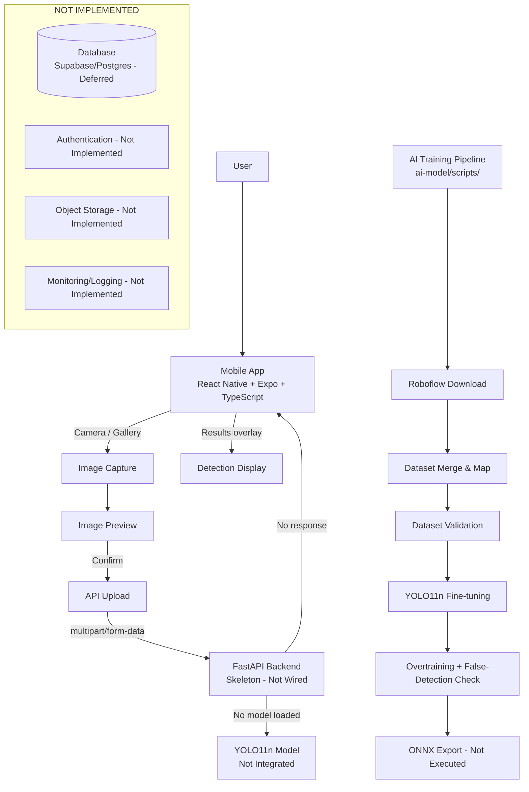

# 02 Current Architecture — EcoSort AI

**Audit date:** 2026-11-17  
**Repository:** `TheAnakin01/ecosort-ai`  
**Branch:** `feature/kaggle-kaggle-notebook-setup`

---

## Actual Technology Stack

| Layer | Technology | Version | Status |
|-------|-----------|---------|--------|
| Mobile | React Native + Expo + TypeScript | SDK ~52 | Implemented (functional) |
| Mobile navigation | Expo Router | — | Implemented |
| Mobile camera | Expo Camera | — | Implemented |
| Mobile gallery | Expo ImagePicker | — | Implemented |
| Mobile state | Zustand | — | Implemented |
| Backend | Python + FastAPI + Uvicorn | — | Skeleton only |
| AI/ML training | PyTorch + Ultralytics YOLO11n | ultralytics~=8.4.212 | Pipeline scripts complete, no real training on waste data |
| ONNX export | ONNX opset 17 | — | Script exists, not executed |
| Dataset sourcing | Roboflow (4 projects) | roboflow~=1.7.3 | Downloader script complete, versions unpinned |
| CI/CD | GitHub Actions | — | Lint + test workflow exists; lint failing |
| Documentation | Markdown | — | Extensive |

---

## Folder Structure

```
EcoSort-AI/
├── ai-model/                          # AI training pipeline
│   ├── configs/
│   │   ├── data.yaml                  # 4-class dataset config (path, splits, names)
│   │   ├── class_overrides.yaml       # Manual source-class → EcoSort mappings
│   │   └── datasets.yaml              # Roboflow source config (version pinning)
│   ├── notebooks/
│   │   ├── train_ecosort.ipynb        # Colab notebook (reference)
│   │   └── train_ecosort_kaggle.ipynb # Kaggle unattended training notebook
│   ├── scripts/
│   │   ├── download_datasets.py       # Roboflow download with version pinning + manifest
│   │   ├── prepare_dataset.py         # Merge, map classes, deduplicate, resplit, max-share cap
│   │   ├── validate_dataset.py        # Dataset validation (fails fast on errors)
│   │   ├── train.py                   # YOLO11n fine-tuning with validation-gate, overtraining check
│   │   ├── overfit_check.py           # Overtraining detection from results.csv
│   │   ├── check_hallucinations.py    # False-detection analysis at app thresholds
│   │   ├── export_onnx.py             # PyTorch → ONNX export with provenance JSON
│   │   ├── evaluate.py                # Val/test split scoring with per-class metrics
│   │   ├── predict.py                 # Single-image detection with drawn boxes
│   │   └── dataset_paths.py           # Resolve data.yaml paths (absolute path handling)
│   ├── tests/
│   │   ├── test_download_datasets.py  # Version pinning, config, key checks (no network)
│   │   ├── test_prepare_dataset.py    # Class mapping, merge, dedupe, max-share, provenance
│   │   ├── test_validate_dataset.py   # Dataset validation logic
│   │   ├── test_dataset_paths.py      # Path resolution
│   │   ├── test_training_checks.py    # Overtraining, hallucinations, training blocks
│   │   └── make_synthetic_dataset.py  # Coloured-rectangle smoke test (not waste data)
│   ├── requirements.txt               # ultralytics, roboflow, pyyaml, pillow
│   └── requirements-dev.txt           # pytest, pyyaml, pillow (no PyTorch)
├── backend/                           # FastAPI inference API
│   ├── app/
│   │   ├── __init__.py
│   │   ├── main.py                    # FastAPI app skeleton (endpoints planned, not wired)
│   │   ├── config.py                  # Configuration (inference settings)
│   │   ├── detector.py                # Detector service interface
│   │   ├── onnx_detector.py           # ONNX-based detector (not integrated)
│   │   ├── schemas.py                 # Pydantic request/response schemas
│   │   ├── errors.py                  # Error response contract
│   │   └── guidance.py                # Rules-based sorting guidance
│   ├── tests/
│   │   ├── test_api.py                # API endpoint tests
│   │   ├── test_onnx_detector.py      # ONNX detector tests
│   │   ├── test_onnx_parity.py        # PyTorch vs ONNX parity (needs weights)
│   │   └── test_real_model.py         # Real model test (needs weights)
│   ├── requirements.txt               # Backend dependencies
│   ├── requirements-dev.txt           # Backend dev dependencies
│   ├── requirements-base.txt          # Base dependencies
│   ├── requirements-onnx.txt          # ONNX runtime dependencies
│   ├── Dockerfile                     # Container build
│   ├── .env.example                   # Environment variables template
│   ├── pytest.ini                     # Pytest config
│   └── README.md                      # Backend setup
├── mobile/                            # React Native + Expo app
│   ├── src/
│   │   ├── app/
│   │   │   ├── scan.tsx               # Camera scan screen
│   │   │   ├── results.tsx            # Results display with overlay
│   │   │   ├── _layout.tsx            # Root layout
│   │   │   └── (tabs)/
│   │   │       ├── _layout.tsx        # Tabs layout
│   │   │       ├── index.tsx          # Home tab
│   │   │       ├── learn.tsx          # Learn tab
│   │   │       └── history.tsx        # History tab (placeholder)
│   │   ├── components/
│   │   │   ├── button.tsx
│   │   │   ├── detection-overlay.tsx  # Box overlay on image
│   │   │   ├── scan-line.tsx          # Scan animation
│   │   │   └── scan-row.tsx           # Scan row
│   │   └── lib/
│   │       ├── api.ts                 # API client (placeholder URL)
│   │       ├── types.ts               # TypeScript types
│   │       ├── history.ts             # Local history
│   │       ├── store.tsx              # Zustand store
│   │       ├── photo-store.ts         # Photo storage (mobile)
│   │       ├── photo-store.web.ts     # Photo storage (web fallback)
│   │       ├── boxes.ts               # Box utilities
│   │       ├── categories.ts          # Category definitions
│   │       ├── theme.ts               # Theme tokens
│   │       ├── pick-photo.ts          # Photo picker
│   │       ├── boxes.test.ts          # Box utility tests
│   │       └── history.test.ts        # History tests
│   ├── package.json
│   ├── app.json                       # Expo config
│   ├── tsconfig.json
│   ├── eslint.config.js
│   └── README.md
├── docs/
│   ├── dataset-card.md                # Dataset sources, versions, licenses, class mapping
│   ├── kaggle-training-guide.md       # Kaggle setup and run instructions
│   ├── kaggle-audit-report.md         # Kaggle notebook and script audit
│   ├── training-log.md                # Training runs (1 Colab run, no Kaggle runs)
│   └── EcoSort-AI-Agent-Harness/      # Product documentation pack
│       ├── README.md, AGENT_INSTRUCTIONS.md
│       ├── PRODUCT_REQUIREMENTS.md    # PRD
│       ├── MVP_SCOPE.md               # MVP boundaries
│       ├── ARCHITECTURE.md            # System architecture (proposed)
│       ├── AI_MODEL.md                # Model specification
│       ├── DATASET_AND_ANNOTATION.md  # Dataset sourcing
│       ├── MOBILE_UI_UX.md            # UI/UX specification
│       ├── BACKEND_API.md             # API specification
│       ├── DATABASE_DESIGN.md         # Proposed later-phase schema
│       ├── SECURITY_PRIVACY.md        # Security and privacy requirements
│       ├── TESTING_AND_ACCEPTANCE.md  # Test strategy
│       ├── ROADMAP.md                 # Phased roadmap
│       ├── DEPLOYMENT_AND_RELEASE.md  # Deployment plan
│       └── OPEN_QUESTIONS.md          # Open product decisions
├── docs/production-audit/             # This audit (new)
│   └── 01_EXECUTIVE_SUMMARY.md
├── .github/workflows/
│   └── tests.yml                      # Lint + test CI (lint failing)
├── .github/workflows/
│   └── deploy-web.yml                 # Web deployment (planned)
├── ruff.toml                          # Ruff lint config
├── .gitignore                         # Protects .env, *.pt, downloads, datasets, runs
├── AGENTS.md                          # Agent rules
└── CLAUDE.md                          # Claude project instructions
```

---

## System Architecture (Current State)



---

## Data Flow (Current State)

### Mobile → Backend (Not Functional)

1. **Mobile** captures image via Expo Camera or selects from gallery via Expo ImagePicker.
2. **Mobile** previews image; user confirms.
3. **Mobile** attempts `POST /api/v1/detect` to `https://api.example.com` (placeholder — no backend).
4. **Backend** skeleton exists (`main.py`) but has no detect endpoint wired to a model.
5. **No response** is returned; mobile app cannot complete a scan.

### AI Training Pipeline (Functional, Not Executed on Real Data)

1. **Download:** `download_datasets.py` pulls 4 Roboflow datasets using `ROBOFLOW_API_KEY`.
2. **Merge:** `prepare_dataset.py` maps source classes to 4 classes, deduplicates, resplits 70/20/10, caps organic at 30%.
3. **Validate:** `validate_dataset.py` checks for errors (missing pairs, invalid boxes, split leakage, empty classes).
4. **Train:** `train.py` fine-tunes YOLO11n from `yolo11n.pt`, early stops at patience=10, max 30 epochs.
5. **Check:** `overfit_check.py` and `check_hallucinations.py` analyze overtraining and false detections.
6. **Export:** `export_onnx.py` converts `best.pt` → ONNX (script exists, not executed).
7. **Evaluate:** `evaluate.py` scores on val/test split (test not yet run).

---

## External Integrations

| Service | Purpose | Status | Credentials |
|---------|---------|--------|-------------|
| Roboflow | Dataset download (4 projects) | Script ready, not run | `ROBOFLOW_API_KEY` (Kaggle Secrets) |
| Kaggle | GPU T4 x2 training | Notebook ready, not run | None (Kaggle-managed) |
| ntfy.sh | Training notifications | Optional, not configured | `NTFY_TOPIC` (optional) |
| Backend API | Inference | Placeholder URL only | None configured |

---

## Key Gaps Between Documentation and Implementation

| Area | Document Says | Code Actually Does | Gap |
|------|--------------|-------------------|-----|
| Backend detect endpoint | `POST /api/v1/detect` with image upload | Skeleton only; no endpoint wired | Critical |
| Model loaded at startup | Model loaded once per process | Not implemented | Critical |
| Mobile → real API | `https://api.example.com` placeholder | No real backend | Critical |
| Test-split evaluation | Run once on final model | Never executed | High |
| ONNX export | Export `best.pt` → ONNX | Script exists, not run | High |
| Database | Deferred to later phase | Not implemented | Medium (deferred by design) |
| Authentication | Deferred to later phase | Not implemented | Medium (deferred by design) |
| CI/CD | Lint + test workflow | Lint failing; cannot merge | High (blocks main) |
